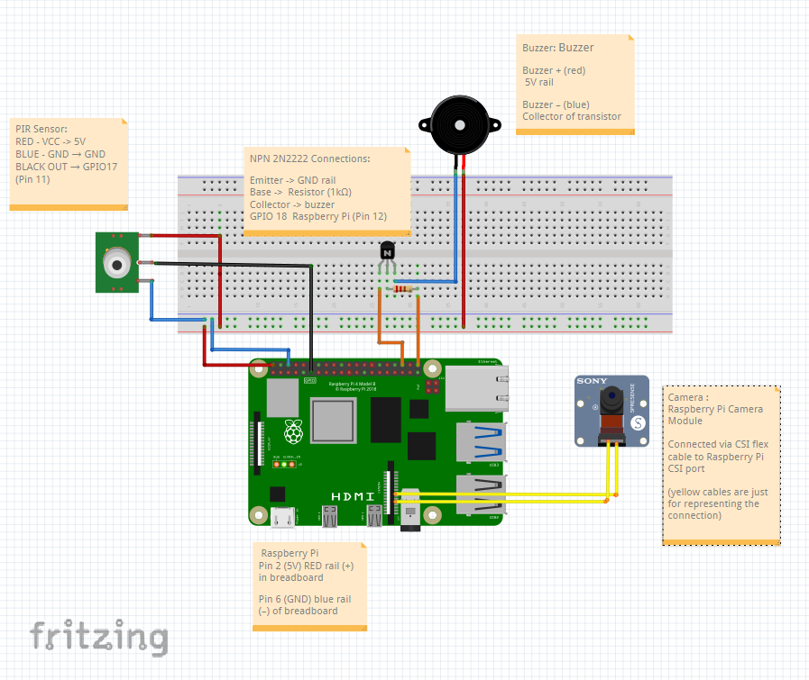

# IoT Security Device – Raspberry Pi (Vigil)

This repository contains the software and hardware configuration for the Raspberry Pi used as the IoT device in the Vigil IoT Security Monitoring System.

The Raspberry Pi acts as a standalone security device responsible for detecting motion, capturing evidence, triggering alarms, and communicating securely with a cloud-hosted backend using PubNub and HTTPS.

This repository represents the IoT hardware and device-side software component of the overall system.

---

## Device Overview

The Raspberry Pi operates as an autonomous IoT security node with the following responsibilities:

- Monitor motion using a PIR sensor
- Automatically capture images when motion is detected
- Trigger an audible alarm using a buzzer
- Upload captured images securely to the backend
- Publish real-time events to the cloud using PubNub
- Listen for remote commands (ARM / DISARM) from the web application
- Operate continuously without exposing any inbound network services

---

## Hardware Components

The following hardware components are used:

- Raspberry Pi (Model 4)
- PIR Motion Sensor (GPIO input)
- Raspberry Pi Camera Module (CSI interface)
- Active Buzzer
- NPN Transistor (2N2222)
- Resistor (1kΩ)
- Breadboard and jumper wires

---

## Hardware Wiring Diagram (Fritzing)

The diagram below shows the physical wiring of the Raspberry Pi, PIR sensor, buzzer circuit, and camera module.



Key connections:

- PIR sensor OUT pin connected to GPIO 17
- PIR sensor powered via 5V and GND rails
- Buzzer driven through an NPN transistor controlled by GPIO 18
- Camera connected via CSI ribbon cable to the Raspberry Pi camera port

---

## Technologies Used

### Software

- Python 3
- PubNub Python SDK
- Requests (HTTP client)
- RPi.GPIO
- dotenv (environment variable loading)

### Communication

- PubNub Publish/Subscribe
- PubNub Access Manager (PAM)
- HTTPS (TLS)

---

## Device Responsibilities

The Raspberry Pi performs the following functions:

- Detects motion using a PIR sensor connected to GPIO
- Captures images using the Raspberry Pi camera
- Triggers an alarm via a buzzer when motion is detected
- Uploads images to the backend using HTTPS POST requests
- Publishes events such as:
  - motion_detected
  - photo_uploaded
  - photos_uploaded
  - device_online
- Subscribes to command messages from the backend
- Executes commands such as ARM and DISARM in real time

---

## PubNub Communication

PubNub is used as the real-time messaging layer between the IoT device and the cloud backend.

- Each device is identified using a unique DEVICE_ID
- The device subscribes to a command channel:
  vigil_cmd_<device_id>
- The device publishes events to:
  vigil_evt_<device_id>
- PubNub Access Manager (PAM) tokens are used to restrict:
  - Which channels the device can publish to
  - Which channels the device can subscribe to
- All PubNub traffic is encrypted using TLS

This ensures that only authorized devices and servers can exchange messages.

---

## Backend Communication

In addition to PubNub messaging, the device communicates with the backend using HTTPS.

- Images are uploaded using HTTPS POST requests
- Upload requests require a valid X-Upload-Token header
- A heartbeat endpoint is used to signal device availability
- No inbound ports are opened on the Raspberry Pi

All communication is outbound-only.

---

## Security Considerations

Security was a core design requirement for the IoT device.

### Device Security

- No web server runs on the Raspberry Pi
- No inbound ports are exposed
- The device communicates outbound-only
- The device is bound to a unique DEVICE_ID

### Secret Management

- All secrets are stored in a local .env file
- No credentials or tokens are hardcoded
- The .env file is excluded from version control

### Communication Security

- HTTPS is used for all backend communication
- PubNub channels are protected using PAM tokens
- Unauthorized publish or subscribe attempts are rejected

---

## Configuration

The device is configured using environment variables stored in a `.env` file.

Required variables:

- DEVICE_ID
- PUBNUB_PUBLISH_KEY
- PUBNUB_SUBSCRIBE_KEY
- PUBNUB_DEVICE_TOKEN
- BACKEND_URL
- UPLOAD_TOKEN

Example `.env` values are documented but not committed to the repository.

---

## Running the Device

Activate the virtual environment:

```bash
source .venv/bin/activate
```
##Run the device application:

```bash
python3 security_device.py
```

##When running, the device will:

- Connect to PubNub

- Announce its online status

- Begin monitoring for motion events

- Respond to ARM and DISARM commands

- Upload evidence automatically when motion is detected

The device is designed to run continuously. It can optionally be configured as a systemd service for automatic startup.

Role in the Overall System
This repository represents the IoT device portion of the Vigil system.

The web application and database are hosted separately on AWS

The Raspberry Pi focuses exclusively on sensing, actuation, and secure communication

All control and monitoring is performed remotely via the web dashboard

Together, the device and backend form a complete, secure, cloud-connected IoT security system.
